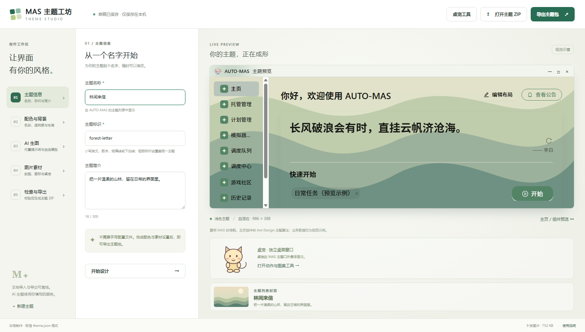
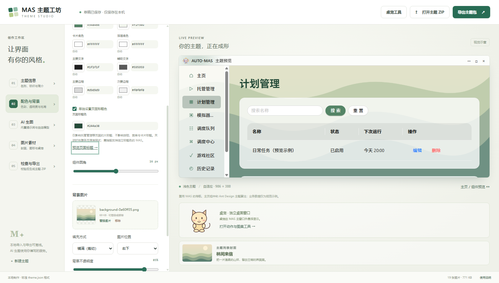
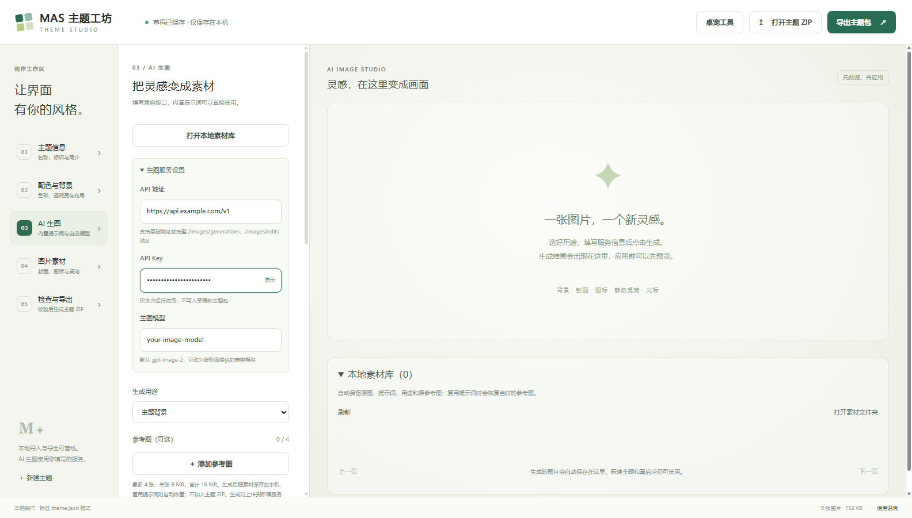
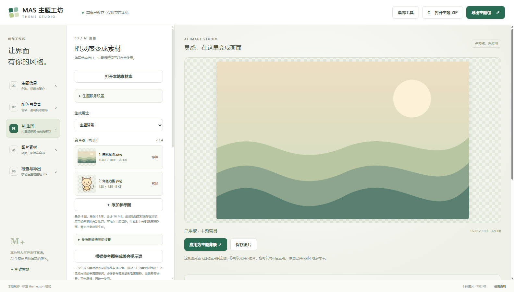
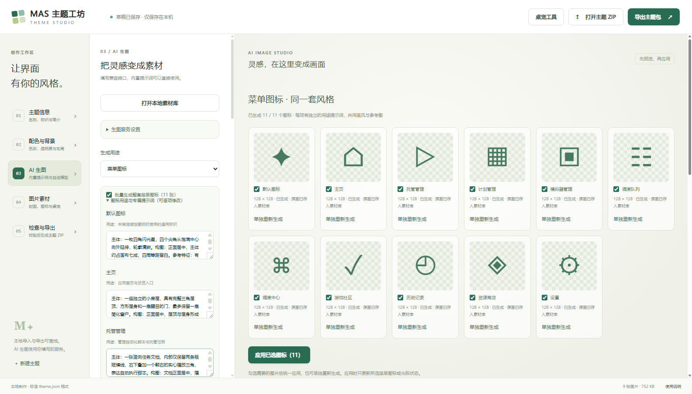
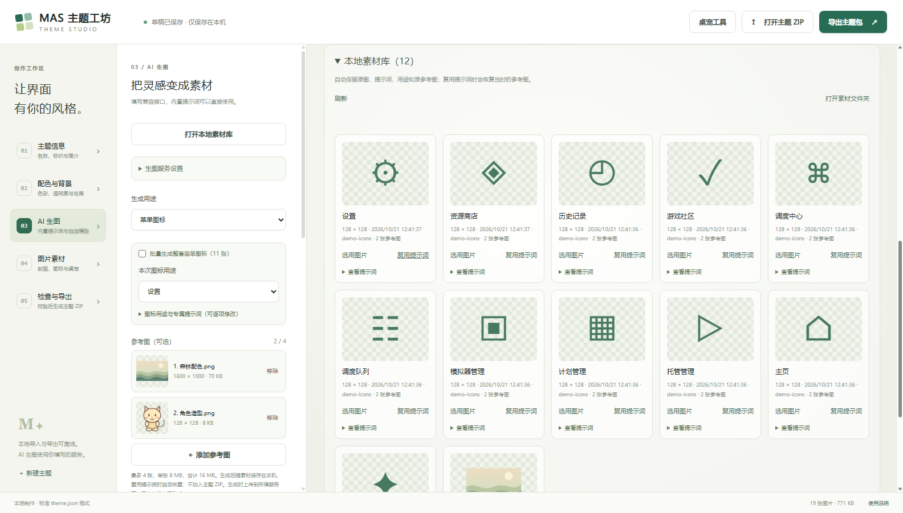
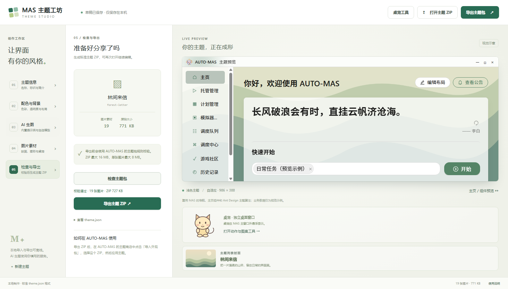

# MAS 主题工坊操作指南

从一组图片制作 AUTO-MAS 主题，也可以用自己的生图服务生成背景、图标和静态桌宠。

截图来自实际工具界面，使用附带的「林间来信」示例和本地演示素材展示操作，没有调用付费模型。截图中的示例 API 地址、模型名和图标效果不代表实际服务；使用时请填写你自己的服务配置。

工具右下角的「使用说明」打开本指南的在线版本。离线时可在解压目录直接打开随包附带的 `guide.md`，截图位于旁边的 `docs/images/`。

## 1. 打开工具，建立主题

1. 从 [Releases](https://github.com/jinghero/AUTO-MAS-Theme-Studio/releases/latest) 下载 Windows 便携 ZIP。
2. **完整解压**，双击 `MAS主题工坊.exe`。不要只复制 EXE，旁边的 `resources`、`locales` 等目录也要保留。
3. 在「主题信息」填写名称、标识和简介。标识使用小写英文、数字、短横线或下划线，例如 `forest-letter`。
4. 想先体验，可以点击右上角「打开主题 ZIP」，选择附带的 `示例主题-林间来信.zip`。

同一标识在 AUTO-MAS 中表示同一个主题。打开 ZIP 或新建主题会替换当前草稿，需要保留的主题请先导出。



## 2. 导入自己的背景和素材

- **配色与背景**：选择浅色或深色模式、主题色，导入背景，调整背景与卡片的不透明度、填充方式和位置。
- **图片素材**：导入主题封面、逐菜单图标、桌宠形象、鼠标光标。可以直接把图片拖入对应素材区域。
- **桌宠**：单图用于静态形象；已有动画请导入桌宠 ZIP，动作与图集会一起保留。

各项素材都可不设置。支持 PNG、JPEG、WebP，单张最大 8 MB、宽高不超过 8192 像素；光标须为 64 像素以内的 PNG。右侧随窗口大小实时预览主题。

想让大标题更清晰，可以在「配色与背景」勾选「单独设置页面标题色」，再选择颜色或填写六位十六进制颜色，例如 `#244a38`。点击「预览页面标题」查看计划管理大标题，也可在预览侧栏切换其他页面。它只影响页面大标题，按钮与菜单继续使用主题色。

旧主题默认不启用此项，取消勾选即可恢复各页原有样式。切换模式或配色灵感会保留独立标题色，恢复 MAS 默认配色会清除。需要使用支持独立标题色的 MAS；较旧 MAS 会忽略此项。



## 3. 配置 AI 服务

进入左侧「AI 生图」，展开「生图服务设置」。

| 字段 | 填写内容 |
| --- | --- |
| API 地址 | 服务商提供的 OpenAI 兼容地址，通常是 `https://你的服务地址/v1`；也接受完整的图片接口地址 |
| API Key | 你自己的密钥，只在当前运行期间使用，重启后需重新填写 |
| 生图模型 | 服务商实际提供的生图模型名，不能直接用看图模型替代 |

软件可使用默认地址，也可自行修改。截图中的 `https://api.example.com/v1` 与 `your-image-model` 是占位示例，不能直接使用。工具通过所填 API 计费，不使用 ChatGPT 或 Codex 网页订阅额度。



## 4. 添加参考图，生成提示词与图片

1. 选择「生成用途」，例如「主题背景」。
2. 点击「添加参考图」，选择人物、配色或风格参考。最多 4 张，单张不超过 8 MB，总计不超过 16 MB。
3. 可以直接编辑提示词，例如“参考第 1 张的森林配色和第 2 张的角色轮廓，主体放在右侧，左侧留白”。
4. 想让模型先写提示词，展开「参考图转提示词设置」，填写支持图片输入的**看图模型**，再点击「根据参考图生成整套提示词」。一次生成背景、封面、菜单图标、桌宠和鼠标光标各自的灵感风格与提示词，以及 11 个菜单图标和 3 个光标的专属提示词。
5. 在候选区切换用途逐项查看、编辑，确认后点击「使用整套提示词」统一应用。各用途分别保存风格和提示词，切换用途或重启后仍保留；生图时仍会带上最初添加的参考图。看图结果不完整、取消或失败时会保留原有输入。
6. 检查尺寸、提示词和参考图，点击「参考图生成」。没有参考图时，按钮显示为「生成图片」。
7. 在右侧检查结果，点击「应用为主题背景」或其他对应用途；「保存图片」可另外保存一份原图。

看图默认复用生图服务的地址和密钥。如果服务商没有看图能力，可勾选「使用独立的看图服务」单独填写。看图与生图是两个请求，按服务商规则分别计费。

添加参考图后，生图服务需要支持 `/images/edits`；无参考图时使用 `/images/generations`。工具兼容返回图片的 Images API，不支持异步任务轮询。参考图只会在你点击看图或生图时上传到所填服务。



## 5. 一次制作整套菜单图标

1. 将用途改为「菜单图标」。
2. 勾选「批量生成整套菜单图标（11 张）」。
3. 展开「图标用途与专属提示词」，按需修改每项的主体部件、构图与留白、参考图特征及其应用部位；共同画风与参考图会同时使用。看图生成的专属提示词也按这几项细化，避免只有名称或一句“沿用参考图风格”。
4. 点击「批量生成 11 个图标」，查看右侧逐项生成的结果。
5. 取消勾选不想使用的图标，点击网格下方的「应用已选图标」。也可以只对某一项点击「单独重新生成」。

整套包含 10 个正式菜单与默认图标，**会顺序发起 11 个独立请求、分别计费**。例如主页默认要求房屋、计划管理要求日历、设置要求齿轮，每项都有自己的用途说明。开发者入口不出现在选择列表中，旧包中已有的隐藏图标仍会保留。

取消或请求失败后，已完成结果会保留，点击「继续生成未完成项」即可接着做。原图写入素材库失败时会暂停，先点击「重试保存到素材库」；这个操作不会再次调用生图接口。

应用时图标会按比例缩小到 128 像素以内，素材库保留生成原图。透明背景仍取决于实际模型结果及服务对高级透明选项的支持。



鼠标光标也支持成组生成：将用途改为「鼠标光标」，勾选「批量生成整套鼠标光标（3 张）」。默认箭头、手形指针、文本光标分别使用自己的专属提示词，共用风格与参考图，逐项请求并计费。失败或取消后可继续未完成项，也可单独重新生成；勾选后点击「应用已选光标」，只替换所选光标状态，保留菜单图标。原图存入素材库，应用时缩小至 64 像素以内；可在「图片素材」选择光标状态并调整热点。

继续未完成批次时，请保留原有的共同提示词、风格、各项专属要求和参考图顺序。工具会检查输入是否一致；改动后需恢复原输入，或点击主生成按钮开始新批次，避免同一套素材混用风格。已生成原图的预览处理失败时，会保留原图；重试该项只重新处理预览，不再次请求生图服务。菜单图标和光标的 16000 字上限包含自动追加的专属要求。

三种光标须保留各自的功能形状：箭头指向左上且尖端清楚，手形食指朝上且指尖不被装饰遮挡，文本光标保持居中的 I 形与对称短横。参考图中的实际配色、笔触、材质和纹样应简化后放到指定部位，避免装饰破坏轮廓。提示词中的预期点击位置不会自动设置软件热点，应用后仍可手动校准。

## 6. 复用提示词时自动带上原参考图

成功生成后，工具会自动保存**生成原图、提示词、用途、模型信息和当时使用的参考图**。新建主题、移动原始参考文件或重启工具都不会清空已归档的素材。

在「AI 生图」点击「打开本地素材库」：

| 操作 | 结果 |
| --- | --- |
| 选用图片 | 恢复生成原图的预览，检查后再应用；不会调用模型 |
| 复用提示词 | 恢复用途、提示词与图标专属要求，并按当时顺序恢复参考图；不会调用模型 |
| 查看提示词 | 展开查看这张图片的完整生成说明 |
| 打开素材文件夹 | 查看本机保存目录 |

**复用提示词会用归档的参考图替换当前选择，而不是追加。** 当时没有参考图的新记录会恢复为 0 张；恢复后可自行增删。再次点击生成时，原参考图会和提示词一起发给当前配置的生图服务。服务地址、模型和密钥请自行确认，密钥不会随素材保存。

v1.3 及更早版本没有归档输入参考图，对应卡片会显示「旧记录未保存参考图」；这类记录复用时会保留当前参考图选择并提醒检查，无法自动找回当时的文件。需要重新添加参考图并生成一次，才能建立完整的新记录。

若已归档的参考图缺失或损坏，工具会提示且保留现有输入。可以恢复完整的 `data` 备份，或从「查看提示词」复制文字后手动添加参考图。



## 7. 检查并导出主题

1. 进入「检查与导出」，点击「检查主题包」。
2. 检查通过后，点击「导出主题 ZIP」，选择保存位置。
3. 在 AUTO-MAS 的主题商店点击「导入外观包」，选择导出的 ZIP 并应用。

ZIP 只包含标准 `theme.json` 和已应用的主题素材，不带 API Key、未选用的生成结果或输入参考图。ZIP 最大 16 MB、最多 31 张图片。之后可用「打开主题 ZIP」继续编辑。



## 8. 桌宠预览与独立导出

顶部「桌宠工具」可单独打开预览器。已有主题桌宠时，在「图片素材」点击「在桌宠工具中预览」，可以检查动作、播放速度、图集和视线效果；点击「导出独立桌宠包」可生成 `mascot.json` 标准 ZIP。

AI 当前生成的是单张静态桌宠，应用它会替换已有动画。制作动画时请使用符合 MAS 图集规则的桌宠 ZIP。

## 9. 升级与备份

正常情况下，草稿和素材库在工具旁边的 `data/`。工具目录不可写时会使用系统应用数据目录，实际位置可在素材库中查看。

```text
data/
├─ draft.json                  当前主题草稿
└─ generated-images/
   ├─ … .png / .jpg / .webp    生成原图
   ├─ … .json                 用途、提示词及参考图对应关系
   ├─ … .thumb.png            小尺寸预览
   └─ references/             原参考图，按内容去重保存
```

升级解压到新文件夹或换电脑时，先退出工具，再复制**整个 `data` 文件夹**到新工具旁。只复制 `draft.json` 或生成原图，会丢失提示词或参考图的对应关系。只想分享主题时，导出主题 ZIP 即可。

开发者可运行 `npm run docs:images` 重新拍摄本指南截图；脚本使用隔离的演示数据，不读取个人草稿，也不会调用付费模型。
